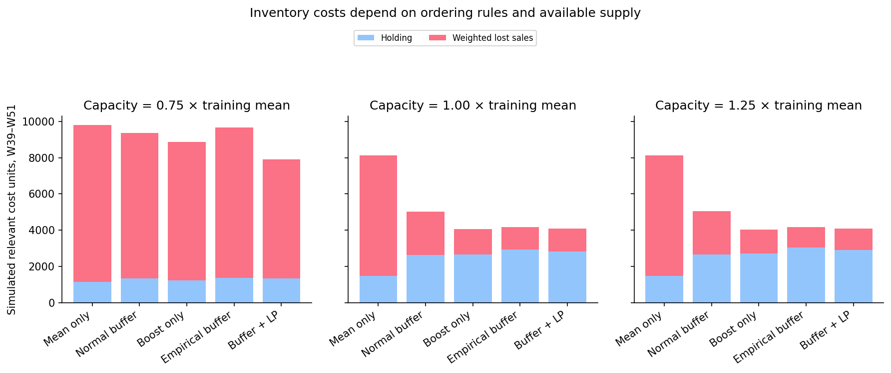

# Demand Forecasting and Inventory Optimization

Connect forecast uncertainty to replenishment decisions and shared supplier capacity. This project compares statistical and ML forecasts, checks empirical interval coverage, simulates lost-sales inventory policies, and allocates limited supply with a scenario linear program.

## Data and experiment

**811 products × 52 weeks** from [UCI Sales Transactions Weekly](https://doi.org/10.24432/C5XS4Q). The source provides quantities and week indices, without actual inventory, costs, availability or calendar dates. A cohort of **30 products**, ten per training-derived ABC class, is selected before the holdout.

Forecast the **three-week protection period** for a weekly review policy with an assumed two-week lead time. Compare five inventory policies under three capacity scenarios: **15 cases**, each with 390 product-week decisions/outcomes.

## Results

On all 811 products at 11 fully observable holdout origins:

| Three-week forecaster | MAE, units | WAPE |
|---|---:|---:|
| Trailing 13-week mean | 4.30 | 16.8% |
| Trailing 4-week mean | 4.75 | 18.6% |
| Pooled boosting | 6.10 | 23.8% |
| Repeat last week | 6.82 | 26.6% |

The simple 13-week mean outperforms boosting on forecast error. Inventory outcomes also depend on safety buffers, capacity and the asymmetric penalties for lost sales.

At weekly capacity equal to the cohort's refit-period mean demand:

| Policy | Relevant cost units | Unit fill rate |
|---|---:|---:|
| Mean only | 8,117 | 89.3% |
| Normal safety buffer | 5,013 | 96.2% |
| Boosting point forecast | 4,064 | 97.3% |
| Empirical upper buffer | 4,176 | 98.0% |
| Empirical buffer + LP allocation | 4,094 | 97.7% |

Under **tight capacity (0.75× mean demand)**, LP allocation reduces weighted simulated cost by **18.1%** relative to proportional allocation using the same empirical-buffer requests: 9,661 → 7,913 cost units. Aggregate fill rate changes from 87.9% to 87.7%, reflecting the assumed class priorities. The LP is not the lowest-cost policy in every scenario.

Costs and lead times are hypothetical. These results are not observed retailer savings. See [methodology](docs/methodology.md) for the cost assumptions and model limits.



## Implemented components

- Raw-quantity validation, exclusion of full-history normalization fields, and training-only ABC classification.
- Lagged and rolling features with explicit forecast origins and fully observed training targets.
- Rolling-origin baseline comparison and chronological boosting-complexity selection.
- Class-pooled normalized residual intervals and upper-demand buffers, with empirical coverage checks.
- Weekly inventory simulation with receipts, two-week lead time, pipeline stock, capacity, fulfillment and lost sales.
- Proportional integer allocation and sparse scenario LP allocation with a feasible integer correction.
- A saved forecast/calibration bundle and a CLI for scoring observed histories.
- An executed notebook, eight figures, thirteen result tables and eleven tests.

## Run

From the repository root, use Python 3.11 or later:

```bash
python -m venv .venv
source .venv/bin/activate
python -m pip install -r requirements.txt
python -m pip install -e . --no-deps
python scripts/download_data.py
python -m pytest -q
python scripts/run_analysis.py
python scripts/execute_notebook.py
```

On Windows, activate with `.venv\Scripts\activate`. The downloadable ZIP includes the original CSV, so the download step can be skipped when `data/raw/Sales_Transactions_Dataset_Weekly.csv` exists. Git excludes raw inputs.

The notebook is `notebooks/demand_inventory_optimization.ipynb`; the executed reading copy is `notebooks/demand_inventory_optimization.html`. Open the notebook within the extracted repository. If needed, install JupyterLab separately with `python -m pip install jupyterlab`.

For environments that prohibit Jupyter kernel sockets:

```bash
python scripts/execute_notebook.py --in-process
```

The in-process option executes every Python cell in a fresh process using IPython and captures actual outputs. Notebook execution regenerates tables, figures, the saved bundle, notebook outputs and HTML. `run_analysis.py` runs the analytical workflow without Jupyter and generates its eleven core tables, configuration and saved bundle.

To generate forecasts from the saved artifact:

```bash
python scripts/score_origin.py --origin 39
```

This saves 811 product forecasts and bounds in `data/processed/forecast_targets.csv`. Input product IDs/order must match the fitted bundle. The forecast uses observations strictly before the requested origin. No inventory order can be inferred from a demand target alone; an operational order also needs on-hand stock and pipeline quantities.

## Repository guide

| File or folder | Purpose |
|---|---|
| `src/demand_inventory/data.py` | Raw validation, training-only metadata and cohort selection |
| `features.py` | Origin-indexed lag and rolling features |
| `forecasting.py` | Pooled boosting, baselines and rolling forecast metrics |
| `uncertainty.py` | Residual quantiles, intervals and scenarios |
| `inventory.py` | Lead-time and lost-sales simulation |
| `allocation.py` | Sparse LP, integer correction and objective audits |
| `pipeline.py` | Shared reproducible workflow |
| `reporting.py` | Reusable chart functions |
| `scripts/` | Download, analysis, scoring and notebook commands |
| `tests/` | Availability, conservation, capacity and optimization checks |
| `reports/` | Forecast, inventory and optimization audits |
| `docs/` | Provenance, methodology, interview and publishing notes |

The module filenames after `data.py` also live under `src/demand_inventory/`.

## Limits

The source contains only 52 weeks. Recorded purchases are an observed-demand proxy; actual stockouts and latent demand are unknown. Simulated weekly demand is revealed after ordering, including units the simulator cannot fulfill. This assumes uncensored feedback.

Calibration uses seven origins with overlapping targets and correlated products. Empirical 90% intervals do not establish an exchangeability-based coverage guarantee; observed class coverage ranges from 85.3% to 91.2%. Weekly unit fill rate is a different quantity from demand-total interval coverage.

The LP minimizes a myopic ending-stock/shortage surrogate. Its relaxed objective supplies an audit bound, rather than a guarantee of globally optimal dynamic inventory performance. Assumed class penalties, the class-balanced cohort, common starting inventory and finite-horizon ordering rule affect the results. Procurement/setup costs, price margins, uncertain lead times and perishability are excluded.

## Sources and license

Tan, J. (2014), [Sales Transactions Weekly](https://doi.org/10.24432/C5XS4Q), UCI, **CC BY 4.0**. Code is **MIT** licensed; dataset terms are separate.

Primary references: [MIT stochastic-demand inventory lecture](https://ocw.mit.edu/courses/15-772j-d-lab-supply-chains-fall-2014/0d50c5c77382852102ee30b98f1d4657_MIT15_772JF14_Lec14.pdf), [SciPy linprog](https://docs.scipy.org/doc/scipy/reference/generated/scipy.optimize.linprog.html), and [Angelopoulos & Bates on conformal prediction](https://arxiv.org/abs/2107.07511).

See [publishing instructions](docs/publishing.md) to push the complete repository and its history to GitHub.
